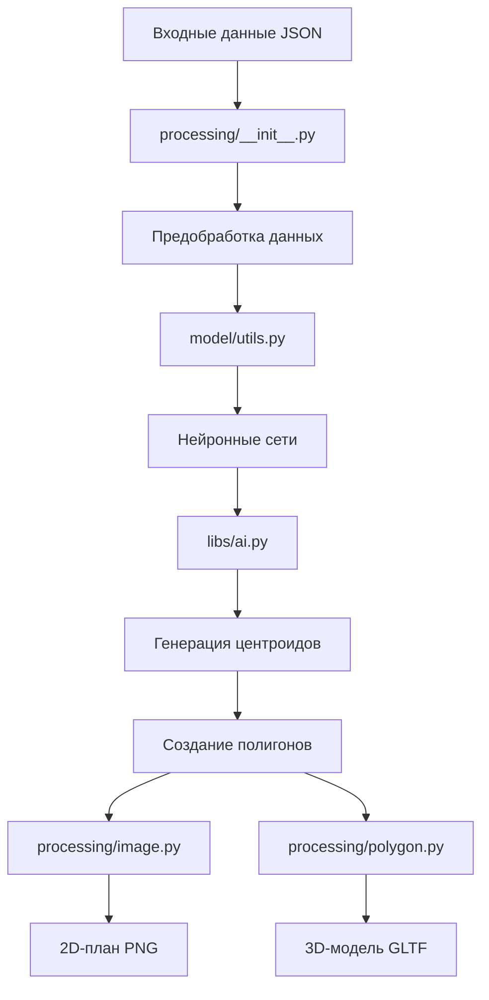
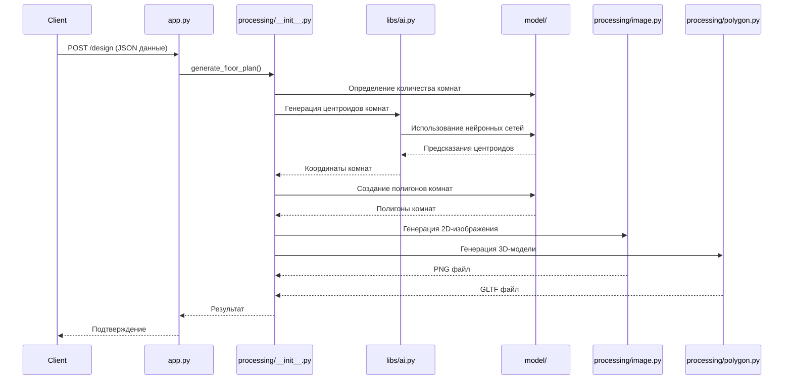

# Plannify: Генератор планов этажей с использованием ИИ

## 1. Структура проекта

```
Plannify-main/
├── app.py                 # Flask-сервер для веб-интерфейса
├── main.py                # Скрипт для пакетной обработки
├── requirements.txt       # Зависимости Python
├── assets/               # Ресурсы (текстуры, изображения, шрифты)
│   ├── textures/         # Текстуры для 3D-моделей
│   ├── *.png             # Иконки помещений
│   ├── *.jpg             # Фоновые изображения
│   └── *.ttf             # Шрифты
├── libs/                 # Основные библиотеки
│   └── ai.py             # ИИ-модуль с нейронными сетями
├── model/                # Модули машинного обучения
│   ├── __init__.py       # Инициализация моделей
│   ├── cnn_models.py     # Архитектуры нейронных сетей
│   ├── resnet.py         # ResNet-модели
│   └── utils.py          # Утилиты для работы с моделями
└── processing/           # Модули обработки данных
    ├── __init__.py       # Основной интерфейс обработки
    ├── 3D.py             # 3D-моделирование
    ├── geometry.py       # Геометрические операции
    ├── image.py          # Обработка изображений
    └── polygon.py        # Работа с полигонами
```

## 2. Описание файлов

### 2.1 Основные файлы

#### `app.py`
**Назначение:** Flask-сервер для веб-интерфейса
**Ключевые функции:**
- `request_test()` - проверка работоспособности сервиса
- `design()` - основной эндпоинт для генерации планов
- `download_model()` - скачивание 3D-модели (GLTF)
- `download_floor_plan()` - скачивание 2D-плана (PNG)

**Связи:** Импортирует `processing.generate_floor_plan`
**Логика:** Принимает JSON-данные с параметрами помещения, генерирует план и возвращает результаты

#### `main.py`
**Назначение:** Скрипт для пакетной обработки входных файлов
**Ключевые функции:**
- `design_all()` - обработка всех JSON-файлов из папки inputs

**Связи:** Импортирует `processing.generate_floor_plan`
**Логика:** Автоматически обрабатывает все входные файлы и генерирует планы

### 2.2 Модуль libs

#### `libs/ai.py`
**Назначение:** Основной ИИ-модуль с нейронными сетями
**Ключевые функции:**
- `get_mask()` - создание масок из полигонов
- `get_rooms_number()` - определение количества комнат по площади
- `get_input()` - подготовка входных данных для нейросети
- `get_centroid()` - генерация центроидов комнат
- `get_polys()` - создание полигонов комнат
- `get_design_single()` - генерация дизайна для одного помещения
- `get_design_enc()` - генерация дизайна с энкодером

**Классы:**
- `Room` - класс для представления комнаты

**Связи:** Использует модели из `model/`, функции из `processing/`
**Логика:** Содержит всю логику машинного обучения для генерации планов

### 2.3 Модуль model

#### `model/__init__.py`
**Назначение:** Инициализация и загрузка предобученных моделей
**Ключевые переменные:**
- `regressor_model` - модель для регрессии центроидов
- `boundaries_model` - модель для определения границ
- `rooms_counts_model` - модель для подсчета комнат

**Связи:** Импортирует модели из `cnn_models.py`
**Логика:** Загружает сохраненные веса моделей и переводит их в режим оценки

#### `model/cnn_models.py`
**Назначение:** Архитектуры нейронных сетей
**Ключевые классы:**
- `RoomLayoutUNet` - U-Net для планировки комнат
- `DecoderCNN` - декодер CNN
- `Encoder` - энкодер CNN
- `CentroidRegressor` - регрессор центроидов
- `XXYYRegressor` - регрессор координат
- `BedBathCountsRegressor` - регрессор количества комнат

**Связи:** Использует `model/resnet.py`
**Логика:** Определяет архитектуры нейронных сетей для различных задач

#### `model/utils.py`
**Назначение:** Утилиты для работы с моделями
**Ключевые функции:**
- `process_centroid_generator_model()` - обработка модели генерации центроидов
- `process_input_boundaries_model()` - обработка модели границ
- `get_rooms_counts()` - получение количества комнат

**Связи:** Использует функции из `processing/`
**Логика:** Содержит функции для предобработки данных и постобработки результатов

### 2.4 Модуль processing

#### `processing/__init__.py`
**Назначение:** Основной интерфейс для генерации планов
**Ключевые функции:**
- `generate_floor_plan()` - главная функция генерации плана

**Связи:** Координирует работу всех модулей processing
**Логика:** Основной пайплайн обработки от входных данных до готового плана

#### `processing/image.py`
**Назначение:** Обработка изображений и визуализация
**Ключевые функции:**
- `get_rects()` - получение прямоугольников из изображения
- `draw_display_picture()` - создание визуализации плана
- `generate_textured_image()` - генерация текстурированного изображения

**Связи:** Использует функции из `geometry.py`, `polygon.py`
**Логика:** Создает 2D-визуализации планов этажей с текстурами

#### `processing/polygon.py`
**Назначение:** Работа с полигонами и 3D-моделирование
**Ключевые функции:**
- `convert_obj_to_gltf()` - конвертация OBJ в GLTF
- `get_mesh()` - создание 3D-меша
- `merge_trimesh_meshes()` - объединение мешей
- `generate_3D_models()` - генерация 3D-моделей

**Связи:** Использует библиотеку trimesh
**Логика:** Создает 3D-модели помещений в форматах OBJ и GLTF

#### `processing/geometry.py`
**Назначение:** Геометрические операции
**Ключевые функции:**
- `get_mask()` - создание масок из геометрических объектов
- `cluster_points()` - кластеризация точек
- `cluster_boxes()` - кластеризация прямоугольников
- `get_door_rect()` - создание прямоугольника двери

**Связи:** Использует библиотеки shapely, opencv
**Логика:** Выполняет геометрические вычисления и преобразования

## 3. Архитектура проекта

### 3.1 Общая структура

Проект построен по модульному принципу с четким разделением ответственности:



### 3.2 Потоки данных

#### Основной поток генерации плана:



## 4. Библиотеки/фреймворки

| Библиотека | Назначение | Где используется |
|------------|------------|------------------|
| **torch** | Глубокое обучение | Все нейронные сети в `model/` и `libs/ai.py` |
| **torchvision** | Компьютерное зрение | ResNet модели в `model/resnet.py` |
| **shapely** | Геометрические операции | `processing/geometry.py`, `libs/ai.py` |
| **opencv-python** | Обработка изображений | `processing/image.py`, `libs/ai.py` |
| **numpy** | Численные вычисления | Весь проект |
| **matplotlib** | Визуализация | `processing/image.py`, `libs/ai.py` |
| **geopandas** | Геопространственные данные | `processing/`, `libs/ai.py` |
| **trimesh** | 3D-моделирование | `processing/polygon.py` |
| **flask** | Веб-сервер | `app.py` |
| **scikit-image** | Обработка изображений | `libs/ai.py` |
| **pillow** | Работа с изображениями | `processing/polygon.py` |

## 5. Точка входа и запуск

### 5.1 Веб-сервер
```bash
python app.py
```
**Что выполняется:**
1. Загружаются предобученные модели
2. Запускается Flask-сервер на порту 5000
3. Доступны эндпоинты:
   - `GET /` - проверка работоспособности
   - `POST /design` - генерация плана
   - `GET /download_model` - скачивание 3D-модели
   - `GET /download_floor_plan` - скачивание 2D-плана

### 5.2 Пакетная обработка
```bash
python main.py
```
**Что выполняется:**
1. Читаются все JSON-файлы из папки `inputs/`
2. Для каждого файла генерируется план этажа
3. Результаты сохраняются в папку `outputs/`

### 5.3 Формат входных данных
```json
{
  "mask": [[x1, y1], [x2, y2], ...],  // Координаты контура помещения
  "door_pos": [x, y],                 // Позиция двери
  "area": 124.23                      // Площадь помещения
}
```

## 6. Архитектурные особенности

### 6.1 Нестандартные решения

1. **Многоэтапная генерация:** Проект использует каскадный подход:
   - Сначала определяется количество комнат
   - Затем генерируются центроиды комнат
   - Потом создаются полигоны комнат
   - В конце генерируются 2D и 3D представления

2. **Гибридный подход:** Комбинирует:
   - Нейронные сети для предсказания
   - Геометрические алгоритмы для оптимизации
   - Компьютерное зрение для постобработки

3. **Модульная архитектура:** Четкое разделение на:
   - Модели машинного обучения (`model/`)
   - Обработку данных (`processing/`)
   - ИИ-логику (`libs/ai.py`)
   - Веб-интерфейс (`app.py`)

### 6.2 Причины выбора архитектуры

1. **Масштабируемость:** Модульная структура позволяет легко добавлять новые модели и функции
2. **Производительность:** Разделение на этапы позволяет оптимизировать каждый компонент отдельно
3. **Гибкость:** Возможность использования как веб-сервиса, так и пакетной обработки
4. **Качество:** Каскадный подход позволяет контролировать качество на каждом этапе

### 6.3 Технические особенности

- **Размер изображений:** Все изображения обрабатываются в формате 256x256 пикселей
- **Форматы выходных данных:** PNG для 2D-планов, GLTF для 3D-моделей
- **Геометрические операции:** Используется библиотека Shapely для точных геометрических вычислений
- **3D-моделирование:** Автоматическая генерация текстур и материалов

## 7. Заключение

Plannify представляет собой комплексную систему для автоматической генерации планов этажей с использованием искусственного интеллекта. Проект демонстрирует современные подходы к компьютерному зрению, геометрическому моделированию и веб-разработке.

Ключевые преимущества архитектуры:
- **Модульность** - легко расширяемая структура
- **Производительность** - оптимизированные алгоритмы
- **Качество** - многоэтапная проверка результатов
- **Удобство использования** - веб-интерфейс и API

---

Автор: legenda  
Telegram: [@LEGENDA_SD](https://t.me/LEGENDA_SD)
